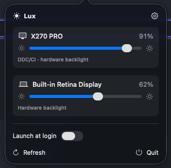

# Lux

[](https://github.com/yipjunkai/lux/actions/workflows/verify.yml)
[](https://scorecard.dev/viewer/?uri=github.com/yipjunkai/lux)
[](https://github.com/yipjunkai/lux/releases)
[](#-license)

**Brightness control for every display on your Mac — built-in and external.** A native Swift menu-bar app that drives the real hardware backlight over DDC/CI, with a universal software fallback so _every_ screen gets a working slider. Global-hotkey macros. No Dock icon. Zero entitlements.



> **ℹ️ Status** — Pre-1.0 and pre-first-release. What's here works today: live per-display brightness (built-in via `DisplayServices`, external via DDC/CI, gamma fallback), global-hotkey macros, and launch-at-login. Time-based automation is next. There's no notarized build yet — [build from source](#-install) to run it now; the Homebrew Cask goes live with the first release.

## ⚡ How brightness control works

There is no single macOS API for this. Lux picks the right mechanism per display and always falls back to something that works:

| Display                                | Mechanism                              | Result                                                              |
| -------------------------------------- | -------------------------------------- | ------------------------------------------------------------------ |
| **Built-in** (MacBook / iMac)          | `DisplayServices` private framework    | Real backlight. Reliable.                                          |
| **External, DDC-capable**              | DDC/CI over I²C (VCP `0x10`)           | Real backlight. Apple Silicon via `IOAVService`, Intel via `IOFramebuffer`. |
| **Apple Studio / Pro Display XDR**     | `DisplayServices` brightness           | Real backlight — special-cased, not DDC.                           |
| **Anything else / DDC broken**         | Gamma dimming (`CGSetDisplayTransferByTable`) | Dims the image, not the backlight. Universal — and dims _below_ the panel minimum. |

**The catch:** DDC support varies wildly by monitor, cable, and especially docks/hubs. Lux probes each display and falls back to gamma automatically, so you always get a slider — even when the panel refuses to expose real brightness.

## 📦 Install

**Homebrew** (once the first release is cut):

```bash
brew install --cask yipjunkai/lux/lux
```

> While builds are unsigned (pre-notarization), add `--no-quarantine`, or right-click `Lux.app` → **Open** the first time.

**From source** — requires the Xcode toolchain (Swift 6+), [`just`](https://github.com/casey/just), and macOS 14+:

```bash
git clone https://github.com/yipjunkai/lux
cd lux
just run          # builds Lux.app (ad-hoc signed) and launches it
```

No Apple Developer account needed for local use. You can also open `Package.swift` directly in Xcode.

## 🚀 Usage

Lux lives in the menu bar (look for the ☀). Click it to:

- **Drag a slider** per display — built-in and external, live.
- **Set up macros** in **Settings** (⚙) — per-display ±N% nudges ("Movie", "Focus", "Bright") bound to **global hotkeys** that fire from any app.
- **Launch at login** with one toggle.

Macros bind to a _stable_ display key, so they survive unplugging and reconnecting a monitor.

### Diagnostics

Read-only helpers for checking DDC support without opening the app:

```bash
just list                # enumerate displays
just get                 # read current brightness per display
just set-brightness 0.5  # set all displays to 50%
just probe               # probe external displays for DDC
just restore             # undo any software (gamma) dimming
```

## ✨ Features

- 🖥️ **Every display, one place** — one slider each for built-in and external monitors.
- 🔦 **Real backlight, real fallback** — DDC/CI and `DisplayServices` where they work; gamma dimming everywhere else.
- 🎛️ **Macros + global hotkeys** — one-tap brightness presets that fire from any app, no accessibility permissions.
- 🔌 **Reconnect-proof** — sliders and macros re-bind automatically when you dock or undock a monitor.
- 🍫 **Menu-bar native** — `LSUIElement`, no Dock icon, launches at login, negligible footprint.

## 🗺️ Coming soon

- [ ] **Time-based automation** — schedule and sunrise/sunset ramps per display.
- [ ] **Ambient-light reactive** brightness.
- [ ] **Absolute presets** and multi-display macros.
- [ ] **More DDC controls** — contrast, input source, volume.
- [ ] **Persist + restore** last-known levels across launches and reconnects.
- [ ] **Notarized Homebrew Cask** release.

## 🏗️ Architecture

- **UI** — a SwiftUI popover hosted in an AppKit `NSStatusItem`; `LSUIElement`, launch-at-login via `SMAppService`.
- **Display layer**
  - `DisplayManager` — enumerates displays (`CGDirectDisplayID`) and matches them to control services.
  - `DDC` / `DDCManager` — DDC/CI VCP over I²C, per-arch transport (`IOAVService` on Apple Silicon, `IOFramebuffer` on Intel), with coalesced writes.
  - `BuiltInBrightness` — `DisplayServices` for built-in / Apple displays, plus change notifications so the UI tracks the brightness keys.
  - `GammaDimmer` — the software fallback via `CGSetDisplayTransferByTable`.
- **Macros** — `HotkeyManager` (Carbon `RegisterEventHotKey`, no permissions) with JSON persistence in `~/Library/Application Support/Lux/`.

Private frameworks are resolved at runtime with `dlopen`/`dlsym`, so the build stays clean and degrades gracefully if a symbol disappears. **Zero entitlements** — DDC, `DisplayServices`, and Carbon hotkeys need none.

## 📁 Project structure

```text
lux/
├── Package.swift             # SPM manifest — executable target, macOS 14+
├── Info.plist                # LSUIElement (menu-bar app, no Dock icon)
├── justfile                  # build / run / diagnostics recipes
├── Sources/Lux/
│   ├── main.swift            # entry point + CLI diagnostic flags
│   ├── App/                  # menu-bar setup, lifecycle, launch-at-login
│   ├── Displays/             # display enumeration + brightness backends
│   │   ├── DisplayManager.swift        # enumerate + identify displays
│   │   ├── DisplayController.swift     # observable state, reconnect handling
│   │   ├── BrightnessController.swift  # unified 0…1 brightness entry point
│   │   ├── DDC.swift, DDCManager.swift # DDC/CI over I²C, per-arch transport
│   │   ├── BuiltInBrightness.swift     # DisplayServices (built-in / Apple)
│   │   └── GammaDimmer.swift           # software gamma fallback
│   ├── Macros/               # global-hotkey macros + JSON store
│   └── UI/                   # SwiftUI (sliders, settings, hotkey recorder)
└── .github/                  # CI, release automation, security, templates
```

## 🛠️ Development

```bash
just build   # compile (debug)
just test    # run the test suite
just lint    # swift-format --strict (the CI gate)
just run     # build the .app bundle and launch it
just         # list every recipe
```

## 📦 Releases

Fully automated from [Conventional Commits](https://www.conventionalcommits.org/): [release-please](.github/workflows/release-please.yml) maintains a release PR; merging it tags `vX.Y.Z` and cuts a GitHub Release. The tag triggers [`release.yml`](.github/workflows/release.yml), which builds a universal `Lux.app`, Developer-ID signs + notarizes it (or falls back to an unsigned build), packages a `.dmg`, and auto-bumps the Cask in [`homebrew-lux`](https://github.com/yipjunkai/homebrew-lux). The required signing secrets are documented at the top of `release.yml`.

## 🤝 Contributing

Issues and PRs are welcome. Run `just lint && just test` before opening a PR; commits follow Conventional Commits (they drive the release). DDC behaviour is very monitor- and dock-specific, so display-compatibility reports (there's an issue template for them) are genuinely useful.

## 📄 License

Dual-licensed under [MIT](LICENSE-MIT) or [Apache 2.0](LICENSE-APACHE), at your option.

Unless you explicitly state otherwise, any contribution intentionally submitted for inclusion in **Lux** by you, as defined in the Apache-2.0 license, shall be dually licensed as above, without any additional terms or conditions.
